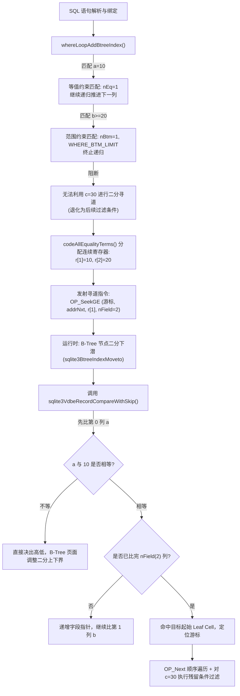

# SQLite 组合索引搜索过程源码深度分析

本文档从 SQLite 源码角度，系统性拆解一个包含**组合索引（Composite Index / Multi-column Index）**的 SQL 查询在内核中的完整搜索过程，涵盖物理存储、编译规划（最左前缀推导）、字节码生成以及运行时 B-Tree 逐列解码比较。

---

## 目录
- [一、组合索引的物理存储结构](#一组合索引的物理存储结构)
- [二、编译规划阶段：最左前缀推导与 WhereLoop 构建](#二编译规划阶段最左前缀推导与-whereloop-构建)
- [三、字节码生成阶段：约束寄存器装配与寻道指令](#三字节码生成阶段约束寄存器装配与寻道指令)
- [四、运行时执行阶段：B-Tree 树高下潜与逐列解码比较](#四运行时执行阶段b-tree-树高下潜与逐列解码比较)
- [五、全流程执行图解与经典案例追踪](#五全流程执行图解与经典案例追踪)

---

## 一、组合索引的物理存储结构

在 SQLite 的 B-Tree 页面中，无论是普通表还是索引，每一行数据都以 **Packed Record** 格式进行序列化打包。
对于组合索引：
```sql
CREATE TABLE t(a, b, c, d);
CREATE INDEX idx_abc ON t(a, b, c);
```
索引在底层 B-Tree（Index B-Tree）中存储的 Cell 格式如下：

```text
+------------------------------------+------------------------------------------------+
|           Record Header            |                  Record Body                   |
| [HdrLen] [s(a)] [s(b)] [s(c)] [sRowid] | [a_bytes] [b_bytes] [c_bytes] [rowid_bytes]   |
+------------------------------------+------------------------------------------------+
```

1. **Header 区域**：
   - `HdrLen`：Varint 变长整数，记录 Header 总字节数。
   - `s(col)`：Varint 编码的 `serial_type`，标明每列的数据类型（NULL、不同宽度的整数、浮点数、字符串、BLOB）及其占用的数据字节长度。
2. **Body 区域**：
   - 各列的实际二进制有效负载紧凑排列，列与列之间没有冗余分隔符。
   - 末尾会追加主键列（如标准 Rowid 表追加 `rowid`，WITHOUT ROWID 表追加 Primary Key），以保证索引条目的全局唯一性。
3. **物理全局有序性**：
   - B-Tree 节点上的所有 Cell 严格按 `(col0, col1, col2, rowid)` 的多列字典序升序/降序排列。
   - 排序优先级遵循：`col0` 决定全局大区间；当 `col0` 相等时，由 `col1` 决定子区间；依此类推。

---

## 二、编译规划阶段：最左前缀推导与 WhereLoop 构建

查询规划器（Query Planner）在处理带有 WHERE 子句的语句时，负责推导组合索引中究竟有**多少列**能够用于 B-Tree 索引二分查找。

相关源码文件：[`src/where.c`](file:///D:/workspace/opensource/sqlite/src/where.c)

### 1. 递归推导机制：[`whereLoopAddBtreeIndex()`](file:///D:/workspace/opensource/sqlite/src/where.c#L3125-L3555)

SQLite 通过递归函数分析组合索引的每一列：

```c
// 截取自 src/where.c:3184-3502
saved_nEq = pNew->u.btree.nEq;
pTerm = whereScanInit(&scan, pBuilder->pWC, pSrc->iCursor, saved_nEq,
                      opMask, pProbe);
for(; rc==SQLITE_OK && pTerm!=0; pTerm = whereScanNext(&scan)){
  ...
  pNew->u.btree.nEq = saved_nEq;
  pNew->aLTerm[pNew->nLTerm++] = pTerm;
  ...
  // 若未达到范围上限（非闭合上界），且索引还有后续列
  if( (pNew->wsFlags & WHERE_TOP_LIMIT)==0
   && pNew->u.btree.nEq<pProbe->nColumn
  ){
    // 递归调用，尝试推导组合索引的下一列 (saved_nEq + 1)
    whereLoopAddBtreeIndex(pBuilder, pSrc, pProbe, nInMul+nIn);
  }
}
```

### 2. 匹配与截断规则（最左前缀原则）

- **等值匹配（`==`, `IS`, `IN`）**：
  - 属于完全匹配，`pNew->u.btree.nEq++`。
  - 索引前缀继续保持单调连续有序，**允许递归检查下一列**。
- **范围约束（`>`, `>=`, `<`, `<=`）**：
  - 触发 `pNew->wsFlags |= WHERE_BTM_LIMIT` 或 `WHERE_TOP_LIMIT`。
  - 范围条件所在的列可以作为索引过滤的边界列（记录到 `nBtm`/`nTop`）。
  - **截断点**：一旦遇到范围条件，后续列在 B-Tree 空间内已不再具备全局单调连续性，因此终止递归，后续列**无法再参与 B-Tree 二分 Seek**。
- **跳跃扫描（Skip-Scan）机制**：
  - 若最左前导列没有约束，但在满足特定条件（如开启了 `SQLITE_SkipScan` 且 `sqlite_stat1` 统计信息显示前导列重复值很高，[where.c:3517-3553](file:///D:/workspace/opensource/sqlite/src/where.c#L3517-L3553)），优化器会尝试构建跳跃扫描计划。

最终，由结构体 [`WhereLoop`](file:///D:/workspace/opensource/sqlite/src/whereInt.h#L129) 记录该组合索引的使用参数：
- `nEq`：连续等值约束的列数。
- `nBtm` / `nTop`：范围下界/上界的约束列数。
- `aLTerm[]`：记录所有参与索引约束的 [`WhereTerm`](file:///D:/workspace/opensource/sqlite/src/whereInt.h) 指针。

---

## 三、字节码生成阶段：约束寄存器装配与寻道指令

确定了最优的索引访问计划后，VDBE 代码生成器负责将索引遍历逻辑翻译为字节码。

相关源码文件：[`src/wherecode.c`](file:///D:/workspace/opensource/sqlite/src/wherecode.c)  
入口函数：[`sqlite3WhereCodeOneLoopStart()`](file:///D:/workspace/opensource/sqlite/src/wherecode.c#L1466)

### 1. 装载多列前缀约束到连续寄存器

调用 [`codeAllEqualityTerms()`](file:///D:/workspace/opensource/sqlite/src/wherecode.c#L892-L960)：
```c
// 截取自 src/wherecode.c:920-960
regBase = pParse->nMem + 1;
nReg = nEq + nExtraReg;
pParse->nMem += nReg; // 分配一段连续的寄存器空间

for(j=nSkip; j<nEq; j++){
  pTerm = pLoop->aLTerm[j];
  // 计算每一列等值条件的值，连续存入 regBase + j
  codeEqualityTerm(pParse, pTerm, pLevel, j, bRev, regBase+j);
}
```
如果存在下界范围约束（如 `pRangeStart`，即 `b >= 20`），其计算结果紧接着被写入 `regBase + nEq`。
此时总的寻道约束列数计算为：
```c
nConstraint = nEq + nBtm;
```
随后调用 [`codeApplyAffinity()`](file:///D:/workspace/opensource/sqlite/src/wherecode.c#L2024) 批量为这批连续寄存器赋予各列对应的类型亲和性。

### 2. 生成 B-Tree 寻道指令（Seek Opcode）

在 [`wherecode.c:2041-2062`](file:///D:/workspace/opensource/sqlite/src/wherecode.c#L2041-L2062)，根据边界算子（`==, >=, >, <=, <`）与正反向扫描标记，从查找表 `aStartOp` 中获取对应的指令：
```c
// 操作码可能为 OP_SeekGE, OP_SeekGT, OP_SeekLE, OP_SeekLT
op = aStartOp[(start_constraints<<2) + (startEq<<1) + bRev];
sqlite3VdbeAddOp4Int(v, op, iIdxCur, addrNxt, regBase, nConstraint);
```
- **P1 (`iIdxCur`)**：被操作的索引游标。
- **P2 (`addrNxt`)**：寻道失败或越界时的跳转目标（即退出当前循环）。
- **P3 (`regBase`)**：包含各列约束值的连续寄存器基址。
- **P4 (`nConstraint`)**：参与寻道对比的字段总数量。

### 3. 生成边界终止判定指令（End-of-Range Opcode）

在循环体内部，若存在上界限制（如 `b <= 50` 或多列等值遍历边界），生成 [`OP_IdxGT` 或 `OP_IdxGE`](file:///D:/workspace/opensource/sqlite/src/wherecode.c#L2140-L2146)：
```c
op = aEndOp[bRev*2 + endEq];
sqlite3VdbeAddOp4Int(v, op, iIdxCur, addrNxt, regBase, nConstraint);
```
每次游标通过 `OP_Next` 向后步进时，都会检查当前索引行是否已超过上界，一旦超过立即跳转到 `addrNxt` 结束遍历。

---

## 四、运行时执行阶段：B-Tree 树高下潜与逐列解码比较

在查询运行时，VDBE 执行上述生成的寻道指令（以 `OP_SeekGE` 为例）。

相关源码文件：
- 虚拟机操作码：[`src/vdbe.c`](file:///D:/workspace/opensource/sqlite/src/vdbe.c)
- B-Tree 树遍历：[`src/btree.c`](file:///D:/workspace/opensource/sqlite/src/btree.c)
- 记录逐字段比对：[`src/vdbeaux.c`](file:///D:/workspace/opensource/sqlite/src/vdbeaux.c)

### 1. 组装 [`UnpackedRecord`](file:///D:/workspace/opensource/sqlite/src/sqliteInt.h#L2724)
在 [`vdbe.c:4929-4959`](file:///D:/workspace/opensource/sqlite/src/vdbe.c#L4929-L4959)：
```c
UnpackedRecord r;
nField = pOp->p4.i;          // 仅约束了前 nField 列
r.pKeyInfo = pC->pKeyInfo;   // 索引各列的 Collation、ASC/DESC 信息
r.nField = (u16)nField;      // 关键：限定参与比较的列数
r.default_rc = ...;          // 针对 >= / > / <= / < 设定的前缀偏向值
r.aMem = &aMem[pOp->p3];     // 指向连续寄存器数组
rc = sqlite3BtreeIndexMoveto(pC->uc.pCursor, &r, &res);
```

### 2. B-Tree 树高下潜与页内二分查找：[`sqlite3BtreeIndexMoveto()`](file:///D:/workspace/opensource/sqlite/src/btree.c#L6000)

1. 从根节点开始，或利用游标缓存直接定位。
2. 在内部页（Interior Page）和叶子页（Leaf Page）中，维护着指向各个 Cell 的偏移量数组。
3. 在页面内执行二分查找（Binary Search）：
   ```c
   // src/btree.c:6094-6113
   idx = (lwr + upr) / 2;
   pCell = findCellPastPtr(pPage, idx);
   c = xRecordCompare(nCell, (void*)&pCell[1], pIdxKey);
   ```

### 3. 核心比较函数：[`sqlite3VdbeRecordCompareWithSkip()`](file:///D:/workspace/opensource/sqlite/src/vdbeaux.c#L4729-L4949)

这是组合索引搜索中最关键的微观实现。它的两个入参为：
- **Key1 (`aKey1`)**：存储在 B-Tree Cell 里的原始 Packed Record 紧凑字节串；
- **Key2 (`pPKey2`)**：由用户查询条件组装的 [`UnpackedRecord`](file:///D:/workspace/opensource/sqlite/src/sqliteInt.h#L2724)。

函数内部通过 `while(1)` 循环按列依次比对：

```c
// 截取自 src/vdbeaux.c:4778-4948
while( 1 ){
  // 1. 从 Key1 Header 解码第 i 列的 serial_type，并定位数据偏移 d1
  serial_type = aKey1[idx1];

  // 2. 根据数据类型，比对 Key1[i] 与 Key2->aMem[i]
  if( pRhs->flags & (MEM_Int|MEM_IntReal) ){
    ... // 解码整数/浮点并比较大小，得出 rc (-1, 0, 1)
  }else if( pRhs->flags & MEM_Str ){
    ... // 调用当前列配置的 Collation 规则（如 BINARY / NOCASE）比较文本
  }

  // 3. 当前列存在差异 (rc != 0)
  if( rc != 0 ){
    if( sortFlags & KEYINFO_ORDER_DESC ) rc = -rc;
    return rc; // 差异已决，整个组合键大小已定，直接返回！不看后续列！
  }

  // 4. 当前列完全相同 (rc == 0)，准备比对下一列
  i++;
  if( i == pPKey2->nField ) break; // 关键：已比完给定的前 nField 列，退出循环！

  pRhs++;                                      // Key2 移动到下一列寄存器
  d1 += sqlite3VdbeSerialTypeLen(serial_type); // Key1 移动到下一个字段数据
  idx1 += sqlite3VarintLen(serial_type);       // Key1 移动到下一个 Header 字段
}

// 5. 前缀列完全匹配
pPKey2->eqSeen = 1;
return pPKey2->default_rc; // 返回预设的偏向符号（>= 返回 +1，<= 返回 -1）
```

---

## 五、全流程执行图解与经典案例追踪

### 案例分析
- 索引：`CREATE INDEX idx_abc ON t(a, b, c);`
- 查询：`SELECT * FROM t WHERE a = 10 AND b >= 20 AND c = 30;`



### 核心结论
1. **最左前缀的本质由 B-Tree 的物理排序决定**：
   只有当前导列是等值匹配时，下一列的取值在 B-Tree 索引中才是全局单调的；一旦出现范围条件，后续列的值在不同分支中交叉分布，无法再通过二分法快速定位。
2. **比较器具有“前缀短路”特性**：
   当 `OP_SeekGE` 传入 `nField=2` 时，比较器只解析比较前 2 列；只要前 2 列满足条件，即判定前缀命中，直接返回寻道结果，避免了解码整行数据的额外开销。
