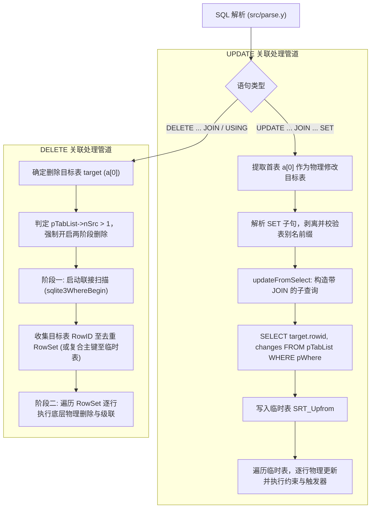

# SQLite 多表关联更新与删除 (UPDATE / DELETE ... JOIN / USING) 设计与实现方案

## 一、 背景与设计目标

### 1.1 背景现状
- SQLite 3.33.0 引入了 PostgreSQL 风格的 `UPDATE ... SET ... FROM ... WHERE ...` 语法，通过两阶段（`updateFromSelect` + 临时表）实现了基本的多表关联更新能力。
- 但是，目前 SQLite 仍存在以下关键缺失：
  1. **不支持 MySQL 风格的 `UPDATE ... JOIN ... SET ...`**：在很多从 MySQL 迁移的项目或 ORM 场景中，JOIN 放置在 SET 之前（如 `UPDATE employees e JOIN departments d ON e.dept_id = d.id SET e.bonus = ...`），当前 SQLite 会报语法错误。
  2. **`SET` 子句不支持表别名限定前缀**：即使用户使用 `UPDATE t1 SET t1.a = 1` 或 `UPDATE t1 AS e SET e.bonus = ...`，SQLite 目前的解析器只接受无前缀列名（`setlist ::= nm EQ expr`），导致 `SET e.bonus = ...` 解析失败。
  3. **`DELETE` 完全不支持多表关联删除**：在 `src/delete.c` 中，存在硬编码的 `assert(pTabList->nSrc == 1)`，不支持类似 PostgreSQL 的 `DELETE FROM t1 USING t2 ...` 或 MySQL 的 `DELETE t1 FROM t1 JOIN t2 ...`。

### 1.2 设计目标
1. **UPDATE 扩展**：
   - 支持 MySQL 风格语法：`UPDATE table1 [AS t1] JOIN table2 [AS t2] ON ... SET ... WHERE ...`。
   - 支持 `SET` 赋值目标带表名或别名前缀（如 `SET e.bonus = expr`），并做合法性校验（必须属于目标修改表）。
2. **DELETE 扩展**：
   - 支持 PostgreSQL 风格：`DELETE FROM table1 [AS t1] USING table2 [AS t2] ... WHERE ...`。
   - 支持 MySQL 风格：`DELETE [t1] FROM table1 [AS t1] JOIN table2 [AS t2] ... WHERE ...`。
3. **语义与安全性保证**：
   - **避免万圣节问题 (Halloween Problem)**：写操作不能干扰正在进行的联接扫描。
   - **1对多关联重复匹配处理**：当 1 对 N 连接导致目标行被多次匹配时，DELETE 必须去重（避免重复删除/报错），UPDATE 依照主键/ROWID 唯一性语义处理。
   - **完整兼容性**：保留对外键级联（FK Actions）、触发器（BEFORE/AFTER/INSTEAD OF）、RETURNING 子句的完整支持。

---

## 二、 系统架构与执行流



---

## 三、 详细模块实现设计

### 1. 语法解析层 (`src/parse.y`)

#### 1.1 UPDATE JOIN 语法扩展
当前 UPDATE 规则：
```lemon
cmd ::= with UPDATE orconf(R) xfullname(X) indexed_opt(I) SET setlist(Y) from(F) where_opt_ret(W) ...
```
扩展支持 `seltablist`（允许直接在 UPDATE 后跟关联联接）：
```lemon
cmd ::= with UPDATE orconf(R) seltablist(X) SET setlist(Y) where_opt_ret(W). {
  sqlite3ExprListCheckLength(pParse, Y, "set list");
  sqlite3Update(pParse, X, Y, W, R, 0, 0, 0);
}
```

#### 1.2 `SET` 子句支持表限定前缀
扩展 `setlist` 产生式，支持 `table.column = expr`：
```lemon
setlist(A) ::= setlist(A) COMMA nm(T) DOT nm(X) EQ expr(Y). {
  A = sqlite3ExprListAppend(pParse, A, Y);
  sqlite3ExprListSetQualifiedName(pParse, A, &T, &X);
}
setlist(A) ::= nm(T) DOT nm(X) EQ expr(Y). {
  A = sqlite3ExprListAppend(pParse, 0, Y);
  sqlite3ExprListSetQualifiedName(pParse, A, &T, &X);
}
```

#### 1.3 DELETE 关联语法扩展
1. **Postgres USING 语法**：
```lemon
cmd ::= with DELETE FROM xfullname(X) indexed_opt(I) using_clause(U) where_opt_ret(W). {
  sqlite3SrcListIndexedBy(pParse, X, &I);
  if( U ){
    X = sqlite3SrcListAppendList(pParse, X, U);
  }
  sqlite3DeleteFrom(pParse, X, W, 0, 0);
}
```
2. **MySQL DELETE JOIN 语法**：
```lemon
cmd ::= with DELETE nm_opt(T) FROM seltablist(X) where_opt_ret(W). {
  sqlite3SrcListSetTarget(pParse, X, &T);
  sqlite3DeleteFrom(pParse, X, W, 0, 0);
}
```

---

### 2. 语义分析与列名解析 (`src/update.c` / `src/resolve.c`)

1. **`SET` 列名前缀验证**：
   - 在 `sqlite3Update` 中遍历 `pChanges` 时，若列具有表别名前缀 `T`，需校验 `T` 是否匹配目标表 `pTabList->a[0]` 的 `zAlias` 或 `zName`。
   - 若匹配，则正常映射到目标表的列编号；若不匹配（试图修改连接中的其他表），报错：
     `sqlite3ErrorMsg(pParse, "cannot update column belonging to joined table: %s", ...)`。
2. **表达式名称解析 (Name Context)**：
   - 当 `pTabList->nSrc > 1` 时，`SET` 右侧的 `expr` 和 `WHERE` 子句需要在包含所有参与 JOIN 的表的 `NameContext` 下解析，保证字段引用（如 `e.salary * 0.1`）正确解析。

---

### 3. 代码生成与执行引擎 (`src/delete.c`)

在 `sqlite3DeleteFrom` 中：
1. **解开单表断言**：
   将 `assert(pTabList->nSrc == 1)` 移除，当 `pTabList->nSrc > 1` 时标记多表模式。
2. **强制两阶段执行 (Disable OnePass)**：
   多表联接时，游标依赖多张表的联合迭代，必须强制 `bComplex = 1` 且 `eOnePass = ONEPASS_OFF`。
3. **两阶段删除流程**：
   - **第一阶段（扫描收集）**：
     调用 `sqlite3WhereBegin(pParse, pTabList, pWhere, ...)` 运行联接扫描，针对匹配到的每一条联接记录，提取目标表的 `rowid`，通过 `sqlite3VdbeAddOp2(v, OP_RowSetAdd, iRowSet, regRowid)` 存入 `RowSet`。`RowSet` 内部自动维护红黑树/有序链表，天然实现 **RowID 自动去重**。
     对于 `WITHOUT ROWID` 表，存入临时表（Ephemeral Table）。
   - **第二阶段（物理删除）**：
     通过 `OP_RowSetRead` 依次读出去重后的 `rowid`，定位到目标表游标，调用现有的底层行删除逻辑（包括索引项删除、外键级联检查、行级触发器执行）。

---

## 四、 关键边界场景

1. **1:N 连接导致多行匹配**：
   - DELETE：`RowSet` 自动去重，只删一次目标行。
   - UPDATE：`updateFromSelect` 机制依靠 `SRT_Upfrom`，检测到多次赋值可按已有语义抛错或更新。
2. **外连接 (LEFT JOIN)**：
   - 若目标表为左表，根据 ON / WHERE 条件可匹配未关联成功的行（右表列为 NULL）。
3. **视图与触发器**：
   - 目标表为视图时，要求必须具备对应的 `INSTEAD OF` 触发器，否则在编译阶段拒绝。
4. **RETURNING 子句**：
   - 支持在 RETURNING 中返回目标表及关联表列。

---

## 五、 测试验证用例

1. MySQL 风格 `UPDATE ... JOIN ... SET e.bonus = ... WHERE ...`
2. 逗号联接 `UPDATE t1, t2 SET t1.val = t2.val WHERE t1.id = t2.id`
3. 带有别名的 `SET alias.col = ...` 与非目标表别名报错验证
4. MySQL 风格 `DELETE t1 FROM t1 JOIN t2 ON ... WHERE ...`
5. PostgreSQL 风格 `DELETE FROM t1 USING t2 WHERE ...`
6. 1 对 N 重复匹配场景下的去重验证
7. 带有触发器与外键约束时的关联更新与删除验证
