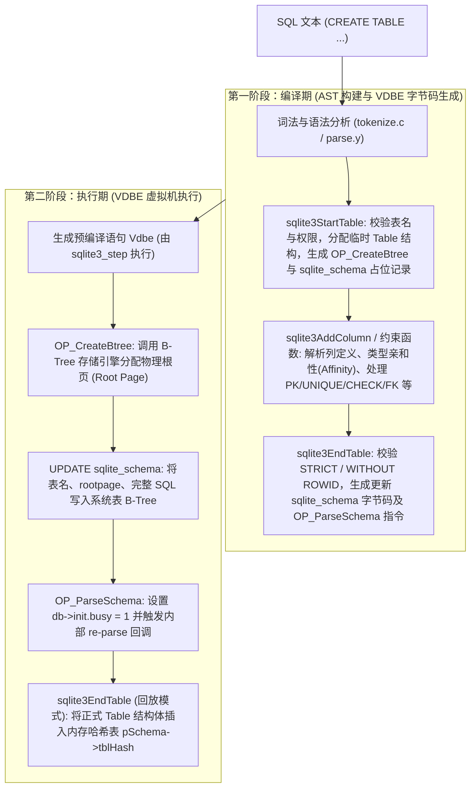

# SQLite 源码：创建表（CREATE TABLE）的处理流程

SQLite 在执行一条数据定义语句（DDL），例如 `CREATE TABLE` 时，其内部处理展现了极其精巧的**两阶段设计**与**模式重放机制**。

与简单的直接修改内存元数据不同，SQLite 的建表流程必须保证事务的 **ACID 特性**（创建失败能回滚、崩溃可恢复、主从/多连接强一致）。因此，SQLite 创造性地将建表过程分为：**编译期规划执行流**、**执行期物理分配与落盘**，最后**通过统一的 Schema 回放机制将其载入内存模式**。

---

## 一、整体流程架构图



---

## 二、第一阶段：编译阶段（Query Compilation & Code Generation）

此阶段由 `sqlite3_prepare_v2()` 驱动，将 SQL 文本翻译为抽象语法树（AST）及对应的虚拟数据库引擎（VDBE）字节码。

### 1. 语法规则入口
* **相关源码：** `src/parse.y`
```lemon
cmd ::= create_table create_table_args.
create_table ::= createkw temp(T) TABLE ifnotexists(E) nm(Y) dbnm(Z). {
   sqlite3StartTable(pParse, &Y, &Z, T, 0, 0, E);
}
create_table_args ::= LP columnlist conslist_opt(X) RP(E) table_option_set(F). {
  sqlite3EndTable(pParse, &X, &E, F, 0);
}
create_table_args ::= AS select(S). {
  sqlite3EndTable(pParse, 0, 0, 0, S);
  sqlite3SelectDelete(pParse->db, S);
}
```
语法分析器遇到 `CREATE TABLE` 头部时调用 `sqlite3StartTable`，随后循环处理列和约束，最后遇到闭合括号 `)` 时调用 `sqlite3EndTable`。

---

### 2. 表头解析：`sqlite3StartTable`
* **相关源码：** `src/build.c`
* **函数签名：**
  ```c
  void sqlite3StartTable(Parse *pParse, Token *pName1, Token *pName2, int isTemp, int isView, int isVirtual, int noErr);
  ```

核心处理逻辑包括：
1. **数据库与表名解析：**
   调用 `sqlite3TwoPartName` 解析表名是属于 `main`、`temp` 还是附加库（attached database），并检查表名命名规范。
2. **鉴权检查（Authorization）：**
   若配置了安全鉴权回调，调用 `sqlite3AuthCheck` 验证是否有权创建表（`SQLITE_CREATE_TABLE` 或 `SQLITE_CREATE_TEMP_TABLE`）。
3. **命名冲突检测：**
   在目标 Schema 命名空间中调用 `sqlite3FindTable` 和 `sqlite3FindIndex` 检查同名表或同名索引是否已存在：
   * 如果存在且未声明 `IF NOT EXISTS`，记录语法错误并中止；
   * 如果指定了 `IF NOT EXISTS`，生成防御性校验代码，安全跳过。
4. **分配编译期临时 `Table` 结构：**
   ```c
   pTable = sqlite3DbMallocZero(db, sizeof(Table));
   pParse->pNewTable = pTable;
   ```
   该结构体仅在编译期充当 AST 容器，暂存列和约束定义。
5. **发射前置 VDBE 字节码：**
   * 调用 `sqlite3BeginWriteOperation` 生成写事务启动指令；
   * **分配根页号占位（`OP_CreateBtree`）：**
     ```c
     pParse->u1.cr.addrCrTab = sqlite3VdbeAddOp3(v, OP_CreateBtree, iDb, reg2, BTREE_INTKEY);
     ```
     这条指令告诉 VDBE 在执行时向存储层申请分配一个新的 B-Tree，并将其根页号存入寄存器 `pParse->u1.cr.regRoot`。
   * **占位预留系统表行（`OP_NewRowid` + `OP_Insert`）：**
     向系统模式表（`sqlite_schema` 或 `sqlite_temp_schema`）插入一条全 NULL 的空白记录，并获取分配到的 `rowid`（存入 `regRowid`）。
     > **设计细节：** 这一步非常关键。提前在 `sqlite_schema` 中占位，可以确保主表的 Schema `rowid` 小于该表后续自动生成的任何索引（如主键唯一索引）的 `rowid`。

---

### 3. 列与约束定义：`sqlite3AddColumn` 及约束例程
* **相关源码：** `src/build.c`

1. **添加列（`sqlite3AddColumn`）：**
   * 检查列数是否超出数据库允许的最大列数限制（`SQLITE_LIMIT_COLUMN`，默认 2000）；
   * 检查同表列名是否重复；
   * 解析数据类型文本，计算列的**类型亲和性（Affinity）**：`INTEGER`、`TEXT`、`BLOB`、`REAL`、`NUMERIC`；
   * 动态扩容 `pTable->aCol` 数组，初始化 `Column` 结构。

2. **解析列约束与表级约束：**
   * **PRIMARY KEY（`sqlite3AddPrimaryKey`）：**
     * 若为单列 `INTEGER PRIMARY KEY`（且未包含 `WITHOUT ROWID`）：该列直接被识别为该表的行号（Rowid）别名，记录在 `pTable->iPKey = iCol` 中，**不会额外创建索引**。
     * 若为其他类型、多列联合主键或带有 `WITHOUT ROWID`：调用 `sqlite3CreateIndex` 生成一个底层唯一的隐式主键索引。
   * **UNIQUE 约束：** 同样调用 `sqlite3CreateIndex` 生成唯一的 B-Tree 索引。
   * **CHECK 约束（`sqlite3AddCheckConstraint`）：** 挂载表达式树到 `pTable->pCheck`，后续调用 `sqlite3ResolveSelfReference` 验证引用的列名合法性。
   * **DEFAULT 约束（`sqlite3AddDefaultValue`）：** 将默认值解析为表达式挂载到 `Column.pDflt`。
   * **FOREIGN KEY 约束（`sqlite3CreateForeignKey`）：** 创建外键描述结构体链表 `FKey`。

---

### 4. 表定义收尾：`sqlite3EndTable`
* **相关源码：** `src/build.c`（约第 2621 ~ 2960 行）
* **函数签名：**
  ```c
  void sqlite3EndTable(Parse *pParse, Token *pCons, Token *pEnd, u32 tabOpts, Select *pSelect);
  ```

当表定义的最后闭括号 `)` 识别完毕后触发：
1. **高级特性校验：**
   * **STRICT 严格模式：** 校验所有列的数据类型必须在五种基础数据类型（`INT`, `INTEGER`, `REAL`, `TEXT`, `BLOB`, `ANY`）之中；并且非 INTEGER 的主键列强制附加 `NOT NULL` 约束。
   * **WITHOUT ROWID 模式：** 校验必须显式指定 `PRIMARY KEY`，禁止使用 `AUTOINCREMENT`；调用 `convertToWithoutRowidTable` 重构内部表形态为纯索引组织表。
   * **Generated Columns（生成列）：** 校验表达式解析与循环引用。
2. **支持 `CREATE TABLE ... AS SELECT`（CTAS）：**
   若存在 SELECT 语句，从查询结果的元数据推导列结构，并在 VDBE 中生成以协程（Coroutine）驱动的批量读写循环指令。
3. **生成回写系统表的指令：**
   拼接完整的建表 SQL 语句，通过 `sqlite3NestedParse` 生成一条字节码指令：
   ```sql
   UPDATE sqlite_schema
   SET type='table', name=%Q, tbl_name=%Q, rootpage=#regRoot, sql=%Q
   WHERE rowid=#regRowid;
   ```
   把运行时获得的 `rootpage` 和完整 SQL 语句回填到此前占位的记录行中。
4. **递增模式 Cookie（`sqlite3ChangeCookie`）：**
   生成 `OP_SetCookie` 指令增加 Schema Cookie 版本号。这样一来，其他连接在检测到 Cookie 变化时，会自动失效并重新加载 Schema 缓存。
5. **发射重新解析模式指令（`OP_ParseSchema`）：**
   ```c
   sqlite3VdbeAddParseSchemaOp(v, iDb,
       sqlite3MPrintf(db, "tbl_name='%q' AND type!='trigger'", p->zName), 0);
   ```
   **这一步是连接编译期与执行期内存更新的枢纽。** 它指示虚拟机在运行完成后，从 `sqlite_schema` 重新把这条记录载入内存。
6. **销毁临时 AST：**
   SQL 编译结束返回 `sqlite3_stmt` 后，编译期间挂载在 `pParse->pNewTable` 上的临时表结构体在 `src/tokenize.c`（`sqlite3DeleteTable`）中被释放，**此时正式的 Schema 尚未载入内存**。

---

## 三、第二阶段：执行阶段（Query Execution & Schema Loading）

当应用层调用 `sqlite3_step(pStmt)` 时，VDBE 调度器 `sqlite3VdbeExec`（位于 `src/vdbe.c`）逐条执行字节码指令。

### 1. 物理分配根页：`case OP_CreateBtree`
* **相关源码：** `src/vdbe.c`
```c
case OP_CreateBtree: {
  Pgno pgno;
  ...
  rc = sqlite3BtreeCreateTable(pDb->pBt, &pgno, pOp->p3);
  pOut->u.i = pgno;
  break;
}
```
* VDBE 调用存储引擎层函数 [`sqlite3BtreeCreateTable`](file:///D:/workspace/opensource/sqlite/src/btree.c)。
* Btree 层向 Pager 申请一个新的物理数据页（优先复用 Freelist 空闲页，若无空闲页则扩展文件尾部增加页数）。
* 该物理页被格式化为一个崭新的 B-Tree 表叶子页（Leaf Page），页号 `pgno` 写入寄存器。

### 2. 持久化元数据到 `sqlite_schema`
* 执行 `UPDATE sqlite_schema ...` 对应的字节码。
* B-Tree 记录写入、更新索引、生成 Undo/Redo 日志或写入 WAL 缓冲。
* 此时，磁盘上的元数据已经完成持久化，且完全受到事务原子性保护。

### 3. 内存模式载入与重放：`case OP_ParseSchema`
* **相关源码：** `src/vdbe.c`
```c
case OP_ParseSchema: {
  ...
  db->init.busy = 1;
  rc = sqlite3_exec(db, zSql, sqlite3InitCallback, &initData, 0);
  db->init.busy = 0;
  ...
}
```
这是 SQLite 架构中最具特色的设计之一：
1. **置位模式初始化标记：** `db->init.busy = 1`，并将目标根页号记录到 `db->init.newTnum`；
2. **执行内部查询：** 执行 `SELECT * FROM sqlite_schema WHERE tbl_name = ...`，获取刚写入的建表 SQL；
3. **触发回调重放：** 通过回调函数 `sqlite3InitCallback` 将 SQL 再次送入 Lemon 词法语法分析器；
4. **进入初始化分支：**
   在解析器中，由于检测到 `db->init.busy == 1`：
   * `sqlite3StartTable` 知道这是模式恢复过程，**不再生成任何 VDBE 指令**；
   * `sqlite3EndTable` 提取 `db->init.newTnum` 作为 `Table.tnum`（根页号），直接调用：
     ```c
     sqlite3HashInsert(&pSchema->tblHash, p->zName, p);
     ```
     将解析生成的正式 `Table` 结构体注册进当前数据库连接的内存哈希表 `pSchema->tblHash` 中。
5. **复位标记：** 模式载入完成，`db->init.busy = 0`。

至此，新创建的表无论是在磁盘存储文件（B-Tree 物理页与系统元数据）还是内存数据字典（`pSchema->tblHash`）中均已就绪，后续的所有 DML 语句（如 `INSERT`、`SELECT`）均可直接命中该表。

---

## 四、核心设计思想与机制剖析

| 设计考量 | 传统直观做法 | SQLite 的实际做法 | 优势与原因 |
| :--- | :--- | :--- | :--- |
| **内存结构绑定时机** | 在编译期 `CREATE TABLE` 解析完成后直接插入 `tblHash` | 编译期只构建临时 AST 并销毁；执行期在 `OP_ParseSchema` 中通过 `sqlite3InitCallback` 载入 | **保证事务一致性**：如果建表事务在 `sqlite3_step` 过程中出错或用户显式 `ROLLBACK`，无需繁琐地回滚内存字典。 |
| **代码复用与单一数据源** | 维护两套代码：一套写表元数据，一套从系统表加载元数据 | **模式重放（Schema Replay）**：打开已有数据库时与新建表时完全共用 `db->init.busy = 1` 解析路径 | 杜绝了“新建表时的内存状态”与“重启加载时的内存状态”不一致的隐患。 |
| **B-Tree 根页分配时机** | 在 SQL 解析时立即去分配物理页面 | 编译期发射 `OP_CreateBtree`，执行期由 VDBE 统一调度调用 `sqlite3BtreeCreateTable` | 纯查询/预编译阶段不产生 I/O 副作用；符合预编译语句（Prepared Statement）与执行解耦的哲学。 |
| **模式表记录顺序** | 顺序写入主表记录和索引记录 | 在 `sqlite3StartTable` 中先占位空行获取 `rowid`，`sqlite3EndTable` 再 UPDATE 回填 | 保证 `sqlite_schema` 中表的行号严格小于从属于该表的索引行号，使启动加载时主表必定先于索引被解析。 |

---

## 五、关键文件速查

* `src/parse.y`: Lemon 语法分析器定义，处理 `CREATE TABLE` 语法规则。
* `src/tokenize.c`: 词法分析器及编译期临时 AST 结构的内存回收。
* `src/build.c`: 模式构造核心，包含 `sqlite3StartTable`、`sqlite3AddColumn`、`sqlite3AddPrimaryKey`、`sqlite3EndTable`。
* `src/vdbe.c`: 虚拟机执行器，包含根页物理分配（`OP_CreateBtree`）与内存模式重放（`OP_ParseSchema`）。
* `src/btree.c`: B-Tree 存储引擎，负责分配并初始化根页（`sqlite3BtreeCreateTable`）。
